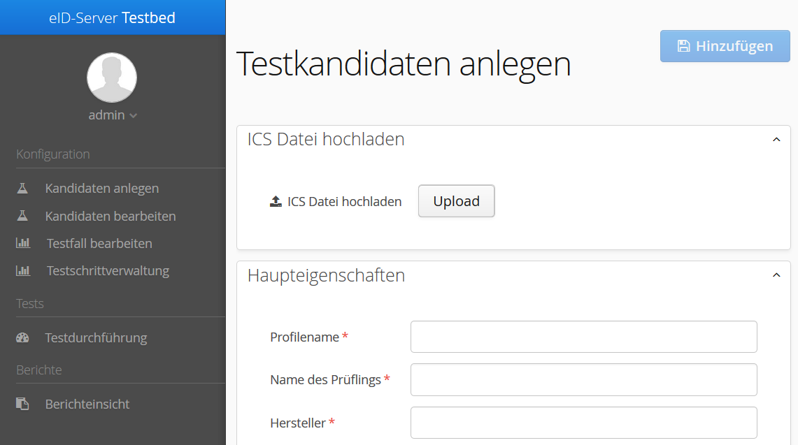

# eID-Server Testbed - Benutzerhandbuch

Dieses Benutzerhandbuch beschreibt die Installation und Nutzung des **eID-Testbed**s, einer Testumgebung zur Prüfung der Konformität von eID-Server-Implementierungen gegenüber der vom Bundesamt für Sicherheit in der Informationstechnik (BSI) veröffentlichten Spezifikation [TR-03130](https://www.bsi.bund.de/dok/TR-03130).

## Einleitung

Im Zuge der Digitalisierung von Geschäfts- und Verwaltungsprozessen ist die sichere elektronische Identifizierung von entscheidender Bedeutung, um das Vertrauen in elektronische Dienstleistungen sicherzustellen. 

Ein zentraler Bestandteil der hierzu entwickelten eID-Infrastruktur ist der eID-Server als eine Hard- und Softwarekomponente beim Diensteanbieter zur Integration der Online-Ausweisfunktion in seine IT-Systeme. Der eID-Server übernimmt dabei die sichere Kommunikation mit dem eID-Client (vgl. [TR-03124](https://www.bsi.bund.de/dok/TR-03124)), dem Chip der eID-Karte und der eID-Anwendung.

Um die Konformität von eID-Server-Implementierungen zu der zugrundeliegenden Spezifikation und die Interoperabilität mit den anderen Komponenten der eID-Infrastruktur sicherzustellen, gibt das BSI eine Reihe von Richtlinien vor. 

Für den Betrieb eines eID-Servers ist es notwendig, dessen Konformität bezüglich der Anforderungen aus der technischen Richtlinie [TR-03130-1](https://www.bsi.bund.de/dok/TR-03130) nachzuweisen. Hierzu wurde vom BSI die technische Richtlinie [TR-03130-4](https://www.bsi.bund.de/dok/TR-03130) entwickelt, welche die notwendigen Konformitätstests definiert und beschreibt. Hersteller müssen zum Nachweis der Konformität eines eID-Servers eine Konformitätsprüfung durch ein zertifiziertes Prüflabor durchlaufen. Basierend auf den Ergebnissen dieser Konformitätsprüfung entscheidet das BSI über die Zertifizierung des eID-Servers.

Um die Konformitätsprüfungen in der Praxis durchführen zu können und Herstellern die Möglichkeit zu bieten, bereits während der Entwicklungszeit ihre eID-Server-Implementierung auf Konformität zu prüfen, wird mit dem im Folgenden vorgestellten **eID-Testbed** ein entsprechendes Prüfwerkzeug bereitgestellt. 

Zur Erstellung des eID-Testbeds wurden die folgenden technischen Richtlinien des BSI herangezogen:

-   [TR-03110](https://www.bsi.bund.de/dok/TR-03110) Advanced Security Mechanisms for Machine Readable Travel Documents
-   [TR-03112](https://www.bsi.bund.de/dok/TR-03112) Das eCard-API-Framework
-   [TR-03124](https://www.bsi.bund.de/dok/TR-03124) eID-Client
-   [TR-03129](https://www.bsi.bund.de/dok/TR-03129) Protocols for the Management of Certificates and CRLs in Public-Key-Infrastructures (PKIs)
-   [TR-03130](https://www.bsi.bund.de/dok/TR-03130) eID-Server

## Installation und Betrieb

Das eID-Testbed ist eine Java-basierte Anwendung auf Basis von **Jakarta EE 8** und **JDK 17**. Das Frontend der Anwendung ist mittels **Vaadin 8** implementiert. Das Buildmanagement erfolgt über **Maven**. Zum Betrieb ist ein JEE8-fähiger Application Server (z. B. Payara v5.2022.5) nötig. 

**Maven Build**

Der Build des eID-Testbeds setzt **JDK 17.0.12+** und [Maven](https://maven.apache.org/) auf dem System voraus. 

Aufgrund von Abhängigkeiten sind die einzelnen Komponenten des Testbeds mittels `mvn clean install` in folgender Reihenfolge zu bauen: 

1. **common-testbed-utilities** (vgl. [readme.md](../../common-testbed-utilities/README.md))
2. **server** (Buildartefakt `eidsrv-testbed-application-[VERSION].ear`; vgl. [readme.md](../README.md))
3. **server-pki** (Buildartefakt `tr03129-[VERSION].war`; vgl. [readme.md](../../server-pki/README.md))

**Inbetriebnahme**

Für die Inbetriebnahme der eID-Testbed Testumgebung werden u.a. eine Datenbank und ein Application Server benötigt. Im Folgenden wird die Inbetriebnahme/Installation unter Nutzung des Payara Application Servers schrittweise beschrieben. 

1. **JDK 17.0.12+** herunterladen und installieren.

2. **Payara Platform Community 5 (v5.2022.5)** als Application Server herunterladen (http://www.payara.fish/downloads). Anschließend das heruntergeladene ZIP-Archiv in einen beliebigen Ordner auf der Festplatte entpacken.

3. **Domain Config einrichten**
Hierzu muss die im `install` Verzeichnis gegebene `domain.xml` Datei in das Verzeichnis des entpackten Payara Servers unter `/glassfish/domains/domain1/config/` abgelegt werden. 

4. **H2 Datenbank bereitstellen**  
Für die Persistierung der Testvorgänge ist im Payara eine JEE 8 kompatible Version der embedded Datenbank H2 bereitzustellen. Das entpackte Archiv von Payara Community 5 beinhaltet bereits eine hierzu passende Version unter `/h2db/bin/h2.jar`. Alternativ kann bspw. die Version [1.4.200](https://www.h2database.com/html/download-archive.html) neu heruntergeladen werden. Das Jar-Archiv der H2-Datenbank ist unter `/glassfish/lib/` abzulegen.  
**Hinweis:**  
Das Testbed speichert im User-Verzeichnis diverse Datenbankdateien ab, wie z. B. `eidtestbed.mv.db`, `eidtestbed.trace.db` sowie `eidtestbed.lock.db`.

5. **Starten des Application Servers** 
  Der Server kann über den folgenden Befehl aus dem `bin` Verzeichnis gestartet werden: `./asadmin start-domain domain1`. Zum Stoppen kann `./asadmin stop-domain domain1` verwendet werden. Weiterführende Hinweise zur Nutzung von Payara, bspw. zum Deployment über die Weboberfläche des Application Servers, finden sich bspw. im offiziellen [Payara Blog](https://blog.payara.fish/how-to-deploy-an-application-on-payara-server-5).

6. **Deployment der Artefakte** 
Anschließend können die kompilierten Artefakte in das `bin` Verzeichnis kopiert und die folgenden Befehle deployed werden:
   * `./asadmin deploy --force eidsrv-testbed-application-[VERSION].ear` (**server**)
   * `./asadmin deploy --contextroot "/CA1" --name "ca1" --force tr03129-[VERSION].war` (**server-pki**)
   * Alternativ können die Artefakte für ein automatisches Deployment im Payara Verzeichnis `/glassfish/domains/domain1/autodeploy` abgelegt werden.

7. Die **Weboberfläche** zur Nutzung des eID-Testbeds kann nun unter [http://localhost:8080/eID-Server-Testbed/](http://localhost:8080/eID-Server-Testbed/) aufgerufen werden. Alternativ auch mittels HTTPS unter [https://localhost:8181/eID-Server-Testbed](https://localhost:8181/eID-Server-Testbed).

Bei zukünftigen Starts von Payara ist lediglich Schritt 5 auszuführen. 

## Benutzung

Dieses Kapitel dient der Beschreibung der Benutzeroberfläche. Es listet die Menüs und entsprechende Seiten auf.

Die Oberfläche des eID-Testbeds setzt sich aus mehreren Webelementen zusammen und bietet den Nutzenden eine Reihe an Funktionen an, hierzu zählen:

- Anlegen eines Testkandidaten
- Editieren von Testkandidaten
- Editieren von Testfällen
- Editieren von einzelnen Testschritten
- Durchführen der Tests 
- Reporting der Testergebnisse

### Grundlegende Nutzerführung

Das Standard-Nutzerinterface des Testbeds besteht aus zwei Teilen - ein Navigationsbereich auf der linken Seite des Bildschirms sowie einen Hauptbereich, in welchem die gewählte Funktionalität dargestellt ist:

 
**Oberflächenaufbau des Testbeds**

Für eine übersichtlichere Nutzerführung und Strukturierung sind die Inhalte in den einzelnen Seiten mit Hilfe von ausklappbaren Elementen strukturiert. Hinweise zu Eingabefeldern sind als Tooltips verfügbar.

### Anlegen eines Testkandidaten

Ein Testkandidat umfasst alle Konfigurationen zur Prüfung eines spezifischen eID-Servers. Der Dialog **Testkandidaten anlegen** erlaubt die Anlage entweder durch den Upload einer XML-ICS-Datei oder durch manuelle Eingabe in der Weboberfläche. Ein XSD-Schema zur Validierung von XML-ICS-Dateien liegt dem Testbed bei ([ics_schema.xsd](../eidsrv-testbed-common/src/main/resources/ics_schema.xsd)). Darüber hinaus steht eine vorausgefüllte XML-ICS-Datei bereit, die einen exemplarischen eID-Servers beschreibt und für den Upload verwendet werden kann ([ics_example.xml](../ics_example.xml)).

Im Falle des Uploads einer ICS-Datei, werden die Werte automatisch geladen und in den Eingabefeldern vorbelegt, fehlerhafte Eingaben werden markiert. Alternativ sind alle Werte manuell einzugeben.

Zur Simulation eines eService und eID-Clients sind folgende Schnittstellen-Angaben notwendig, die aus der ICS-Datei übernommen werden:

-   **eCard-API Adresse (URL)**: Adresse des eID-Server, an der er einen TLS-2 Handshake erwartet und die Nachricht **StartPAOS**.
-   **eID-Interface Adresse (URL)**: Adresse des eID-Server, an der er die SOAP-Kommunikation erwartet.
-   **SAML Adresse (URL)**: Adresse des SAML Prozessors des eID-Servers, an der er die SAML-Kommunikation erwartet.
-   **TCToken (attached) Adresse (URL)**: die Adresse, von der der simulierte eID-Client das TC Token erhält. Diese wird nur benötigt, wenn der eID-Server Attached Mode unterstützt.

Falls der eID-Server mandantenfähig ist, werden mehrere eServices konfiguriert. 

Sobald der Testkandidat angelegt wurde, werden die Zertifikate (CVCA, CSCA, DV, SAML, TLS) vom Testbed generiert und zum Download bereitgestellt. Das Hinzufügen des Testkandidaten kann durch die Generierung einige Sekunden in Anspruch nehmen. 

### Konfiguration des eID-Servers

Nach Anlage eines Testkandidaten ist der eID-Server entsprechend zu konfigurieren.
Hierzu kann in der Ansicht **Kandidat bearbeiten** die generierte Datei `certificates.zip` über die Option „Zertifikate herunterladen“ heruntergeladen werden.

Das bereitgestellte `certificates.zip` ZIP-Archiv weist entpackt die folgende Ordnerstruktur auf:
```
- certificates/
  - candidate_tls/
  - certificates/
  - CVCertificates/
  - eIDAS/
  - keys/
```

Falls der eID-Server mandantenfähig ist, sind die folgenden Schritte je Mandant durchzuführen:

1. TLS-Zertifikate für den eID-Server einrichten. Die TLS-Zertifikate befinden sich im Ordner `candidate_tls`, mit den zugehörigen Schlüsseln im Unterverzeichnis `keys`.
  
2. TLS-Zertifikate für die Testbed-Dienste installieren. Diese befinden sich im Ordner `certificates` nach Algorithmen sortiert und benannt nach Mandanten/Diensten (z. B. `RSA/A.crt` für Mandant A).

3. SOAP- und SAML-Zertifikate installieren. Diese verwenden die gleichen Zertifikate wie TLS, d.h. sie befinden sich ebenfalls im Ordner `certificates`. Die SAML Encryption-Zertifikate tragen die Endung `_ENC` und sind im Format `Mandant_ENC` benannt (z. B. `RSA/A_ENC.crt` für Mandant A). Die Schlüssel befinden sich im `keys` Ordner in den ebenfalls nach Algorithmen benannten Unterverzeichnissen.

4. **Vorgehen mit/ohne PKI**

   4.1 **Falls eine PKI vorhanden ist:**  
   Falls eine PKI vorhanden ist, sind die TLS-Parameter unerheblich, da alle Client-Zertifikate akzeptiert werden. Die für die Signatur der Master-, Black- und Defectlists notwendigen Signer-Zertifikate befinden sich im Verzeichnis `certificates/CSCA` und tragen die Endung `_SIGNER` (z. B. `CERT_ECARD_CSCA_1_MASTERLIST_SIGNER.DER`).   

   4.2 **Falls keine PKI vorhanden ist:**  
   Liegt keine PKI vor, müssen die CV-Zertifikate schrittweise in den eID-Server importiert werden. Hierfür stehen im Verzeichnis `CVCertificates` folgende Unterverzeichnisse zur Verfügung:  
   - Zertifikate unter `/certs`,  
   - Schlüssel unter `/keys`,  
   - Beschreibungen unter `/desc`.  
   
Bei den Zertifikaten gelten folgende Vorgaben:
   - Der Countrycode ist stets `DE`.  
   - Die Mnemonic ist spezifisch für das Terminalzertifikat (z. B. T1A, T1B, T1C, T1D, T1ERSA, T1EECDSA, T1F, T1G).  
   - Die Sequence Number ist standardmäßig `1`.
   
Bei nicht-mandantenfähigem eID-Server:

  - Bei eID-Servern ohne Mandantenfähigkeit sind vor jedem Testlauf die passenden Zertifikate manuell zu importieren, da Änderungen in der Konfiguration für verschiedene Testszenarien erforderlich sind.
  - Das Testbed verwendet standardmäßig die Konfiguration von Mandant bzw. eService A für die Testvorauswahl.

**Hinweis:**    Zusätzlich kann für eIDAS Middleware ab Version 3.x die Konfiguration durch den Import der Datei `eIDAS/eIDASMiddlewareConfig.xml` erfolgen. Diese Datei wird nur vollständig bereitgestellt, wenn das Testbed unter [https://localhost:8181/eID-Server-Testbed](https://localhost:8181/eID-Server-Testbed) in der HTTPS-Variante aufgerufen wird.

### Ändern eines Testkandidaten

Die nachträgliche Änderung eines zuvor angelegten Testkandidaten ist über den Menüpunkt **Kandidat bearbeiten** möglich. Es wird die gleiche Eingabemaske zum Anlegen eines Testkandidaten jedoch mit vorausgefüllten Feldern des ausgewählten Testkandidaten geladen. Vorgenommene Änderungen werden über die Schaltfläche **Editieren** persistiert. 

### Editieren von Testfällen

Das Testbed ermöglicht grundsätzlich nur das Editieren von Kopien der Testfälle, nicht von Testfällen selbst. Dies dient dazu, die Vergleichbarkeit zu wahren. Unter dem Menüpunkt **Testfall bearbeiten** ist es daher nur möglich, einen der Standardtestfälle auszuwählen und anschließend unter Angabe eines Bezeichners im Feld **Anhang** eine Kopie des Falls zu speichern. In dieser Kopie können die einzelnen Schritte des Tests angepasst werden.

Testfallkopien werden grundsätzlich dem gleichen Modul zugeordnet, zu welchem auch die Vorlage gehört. Ein weiteres Kopieren der Testfallkopie ist nicht möglich.

### Editieren von Testschritte

Testfälle bestehen aus einer Menge von Testschritten, die der Reihe nach ausgeführt werden. Diese bilden die ein- und ausgehende Kommunikation mit dem Testkandidaten ab.
Analog zu dem Verhalten für Testfälle können ebenfalls Kopien von einzelnen Testschritten editiert und gespeichert werden.

### Durchführen von Tests

Die tatsächliche Ausführung der Tests ist über den Menüpunkt **Testdurchführung** möglich.

Nutzende können hier zunächst die durchzuführenden Tests für einen eID-Server vor Beginn des Testlaufs über Checkboxen auswählen. 

Einige Tests können nicht ohne eine Konfigurationsänderung des eID-Servers durchgeführt werden, beispielsweise eine Änderung der zu nutzenden Zertifikatskette. Diese Tests sind standardmäßig nicht ausgewählt und müssen manuell aktiviert werden. Solche manuellen Tests haben als Tooltip die Beschreibung der vorab durchzuführenden Änderung. 

Der Standardmandant, für welchen das Testbed im Fall eines nicht-mandantenfähigen eID-Servers die Vorauswahl trifft, ist eService A.

Ein Klick auf **Starte Testlauf** beginnt den Testlauf mit allen gewählten Tests.

### Analyse

Die Testergebnisse werden in Form von Berichten bzw. Reports persistiert und sind über den Menüpunkt **Berichteinsicht** erreichbar. Die Ergebnisse eines Testlaufs werden hierzu in der initial eingerichteten H2 Datenbank gespeichert. Ein Testbericht zeigt u.a. welcher eID-Server in welcher Version getestet wurde und welche Ergebnisse erzielt wurde.

Die Report-Anzeige besteht im Wesentlichen aus zwei Teilen. Zunächst wählt der Nutzer das Profil aus, für welches der Testlauf durchgeführt wurde. Neben dem Profil wird hier auch der konkrete anzuzeigende Testlauf gewählt. Anschließend stehen nur diejenigen Testläufe zur Wahl, welche bereits vollständig abgeschlossen wurden. Nach Auswahl eines Profils erscheinen die dazugehörigen Berichte.

Weitergehende Informationen zu den einzelnen Einträgen werden mittels Popups dargestellt, wobei diese sich für die einzelnen Elemente der Ansicht unterscheiden. Popups für Testfälle beinhalten die Testfallkurzbeschreibung sowie die Liste der Testschritte. Bei Testschritten beinhalten sie hingegen im Falle eines Fehlschlags den Grund für die negative Wertung sowie den Inhalt der empfangenen oder gesendeten Nachricht.

Alternativ zur Einsicht in der Vaadin UI lassen sich die Ergebnisse eines Testlaufs auch in der `server.log` des Applicationservers in Textform untersuchen. Im Falle von Payara ist das Logfile entweder über die Payara Adminconsole einsehbar oder direkt unter `/glassfish/domains/domain1/logs/server.log`.